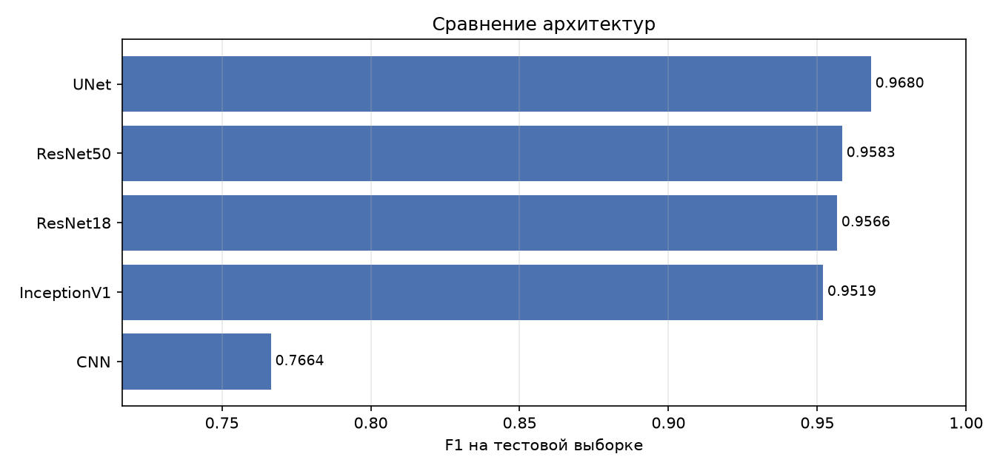

# Результаты

Все строки получены по единому протоколу: одинаковый split, одинаковый бюджет
обучения, свежие веса на каждый эксперимент, чекпоинт и порог отобраны по
валидации, метрики сняты с отложенной тестовой выборки.

Файл сгенерирован скриптом `scripts/report.py` из `results/model_comparison.csv` —
цифры здесь не могут разойтись с посчитанными.

## Сравнение моделей

| name        |     f1 |   roc_auc |   accuracy |   precision |   recall |   threshold | dataset   |   epochs |
|:------------|-------:|----------:|-----------:|------------:|---------:|------------:|:----------|---------:|
| UNet        | 0.968  |    0.9985 |     0.9892 |      0.9772 |   0.9589 |      0.2193 | clean     |       50 |
| ResNet50    | 0.9583 |    0.9977 |     0.986  |      0.9722 |   0.9448 |      0.2144 | clean     |       50 |
| ResNet18    | 0.9566 |    0.997  |     0.9856 |      0.9815 |   0.933  |      0.566  | clean     |       50 |
| InceptionV1 | 0.9519 |    0.9966 |     0.9838 |      0.9627 |   0.9412 |      0.1144 | clean     |       50 |
| CNN         | 0.7664 |    0.9474 |     0.9222 |      0.7838 |   0.7497 |      0.5944 | clean     |       50 |



## Как читать таблицу

**F1 — основная метрика.** Классы несбалансированы (83% реальных лиц), поэтому
accuracy вводит в заблуждение: модель, всегда отвечающая «real», получила бы
около 0.83 без всякой пользы.

**ROC-AUC считается по вероятностям** и не зависит от выбранного порога — он
показывает качество ранжирования отдельно от качества калибровки. AUC от жёстких
меток, который часто считают по ошибке, — это балансированная точность, другая
величина.

**Порог подобран по валидации**, а не зафиксирован на 0.5. При дисбалансе 5:1
оптимум по F1 обычно лежит заметно ниже, и `argmax` (эквивалент порога 0.5)
систематически недобирает recall.

## Что показывают сравнения

_Недостаточно экспериментов для сравнений._

## Воспроизведение

```bash
python scripts/prepare_data.py --all
python scripts/train.py --all
python scripts/report.py
```
